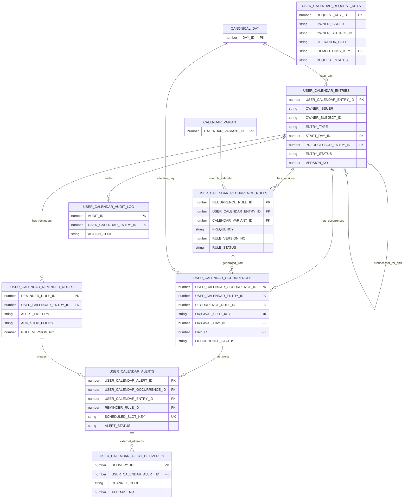

# CAL2 R2-A2 — Conceptual/Logical ERD (not physical DDL)

`USER_CALENDAR_REQUEST_KEYS` belongs to the API command/idempotency boundary and references the resulting resource through a controlled reference, **not** a required FK to Entries (multiple operation kinds can be guarded).

The diagram shows Recurrence Rules with historical revisions; only one may be active at a time per Entry. The relationship from Occurrence to RecurrenceRule is optional for one-time entries. Composite UNIQUE constraints are detailed in the dictionary and require final physical DBA design.
